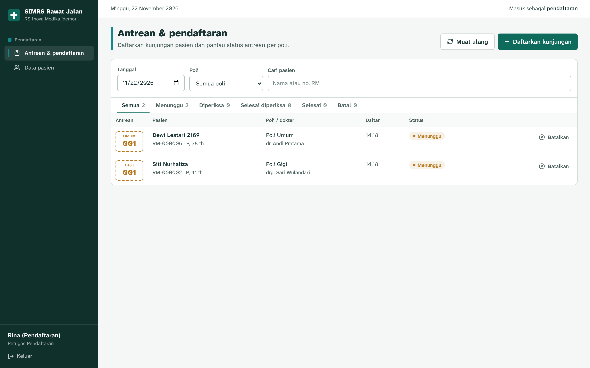
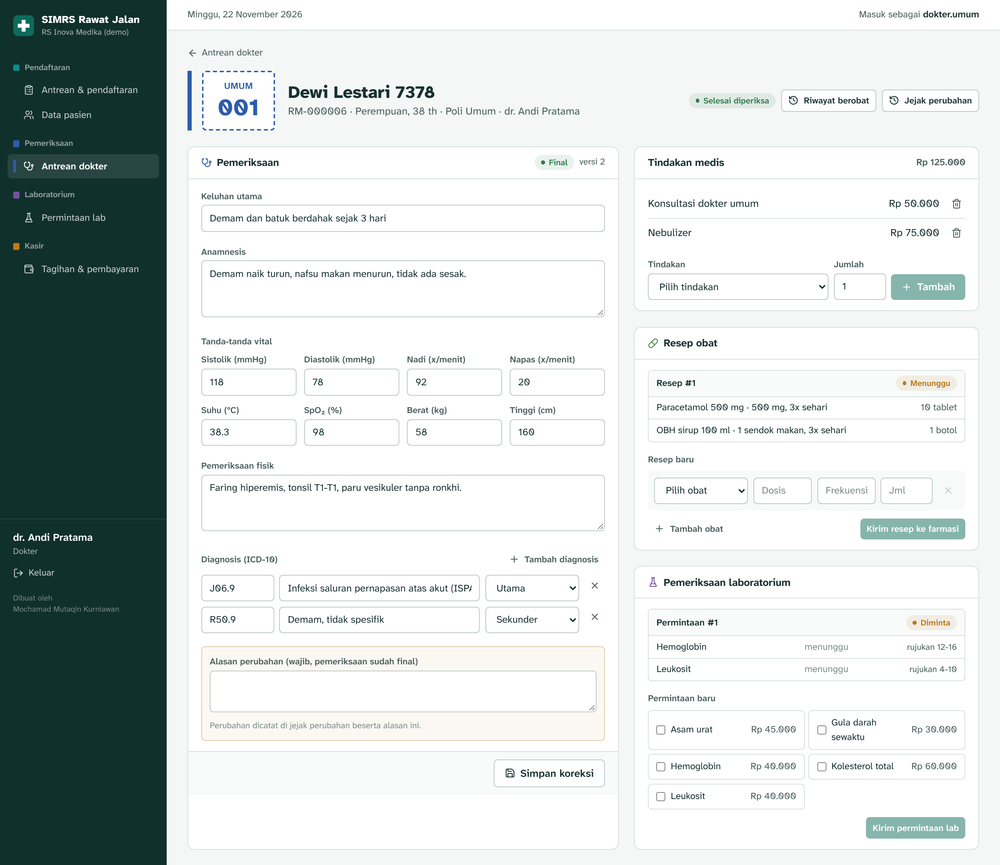
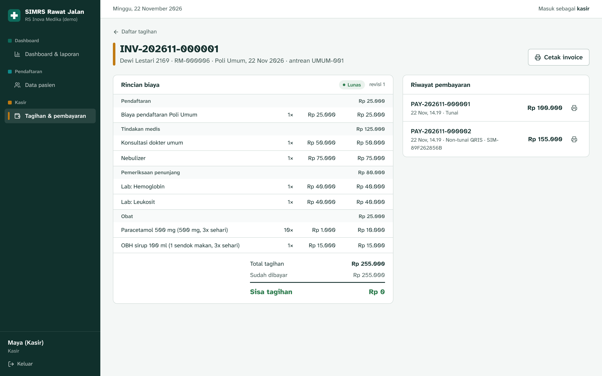
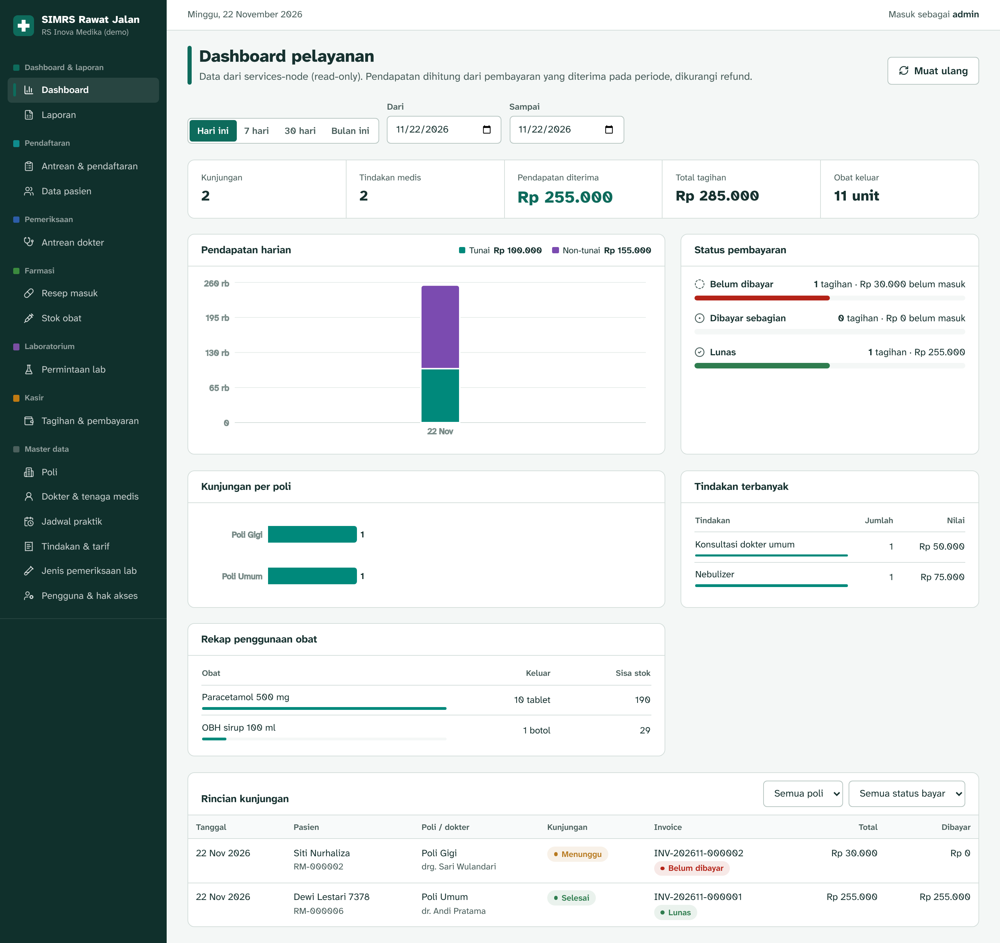

# SIMRS Rawat Jalan Terintegrasi

Real case test Senior Programmer, PT Inova Medika Solusindo. Sistem pelayanan rawat jalan dari pendaftaran
sampai pembayaran: antrean, rekam medis elektronik, tindakan, resep & farmasi, laboratorium, billing,
dashboard, serta hak akses per role.

| Komponen | Teknologi | Folder |
|---|---|---|
| Frontend | React 18 + Vite + Tailwind | [`frontend/`](frontend/README.md) |
| Backend utama (business logic, semua penulisan data) | Yii2 + PHP 8.2 | [`backend-yii/`](backend-yii/README.md) |
| Backend services (lab/integrasi, dashboard read-only) | Node.js + Express | [`services-node/`](services-node/README.md) |
| Database | PostgreSQL 16/17 | [`database/`](database/) |

Arsitektur, ERD, pembagian tanggung jawab Yii vs Node.js, dan penanganan skenario teknis D1–D6:
[`docs/01_arsitektur.md`](docs/01_arsitektur.md).

## Struktur

```
simrs/
├── backend-yii/              API utama (Yii2) + tes Codeception
├── services-node/            API lab & dashboard (Node.js) + tes node:test
├── frontend/                 aplikasi petugas (React) + skrip uji end-to-end
├── database/                 001_schema.sql (skema + seed role), 002 bukti constraint, 003 user read-only
├── docs/                     arsitektur, ERD, screenshot
├── postman/                  collection, environment, laporan pengujian Newman
├── docker-compose.yml        PostgreSQL siap pakai (opsional)
├── setup-windows.bat         setup sekali jalan di Windows
├── start-dev.bat             menyalakan semua service di Windows
└── install-postgres-service.bat  membuat server PostgreSQL bila instalasi Windows tidak lengkap
```

## Menjalankan

### Windows (tanpa Docker)

Prasyarat: PHP ≥ 8.2 dengan `pdo_pgsql` aktif (mis. XAMPP), Composer, Node.js ≥ 20, PostgreSQL 17.

```bat
setup-windows.bat     :: buat database, .env, migrate, user read-only, data demo, npm install
start-dev.bat         :: Yii :8080, Node :3001, worker outbox, frontend :5173
```

Buka **http://localhost:5173**.

### Linux / macOS / Docker

```bash
docker compose up -d                          # PostgreSQL + skema + user app_readonly

cd backend-yii && composer install && cp .env.example .env
php yii migrate && php yii seed/demo
php yii serve 0.0.0.0:8080 &                  # API utama
php yii outbox/run &                          # worker event Yii -> Node

cd ../services-node && npm install && cp .env.example .env
node --env-file=.env src/server.js &          # :3001

cd ../frontend && npm install && npm run dev  # http://localhost:5173
```

## Akun demo

Password semua akun: `password123`

| Username | Role | Yang bisa dicoba |
|---|---|---|
| `pendaftaran` | Petugas pendaftaran | cari/daftar pasien, ambil nomor antrean, batalkan kunjungan |
| `dokter.umum` (juga `dokter.gigi`, `dokter.anak`) | Dokter | panggil pasien, anamnesis, vital sign, diagnosis, tindakan, resep, permintaan lab |
| `lab` | Petugas laboratorium | worklist & input hasil (lewat services-node) |
| `farmasi` | Petugas farmasi | proses resep, serahkan obat, stok & kartu stok |
| `kasir` | Kasir | tagihan, bayar bertahap tunai/QRIS, refund, cetak invoice & bukti bayar, dashboard |
| `admin` | Administrator | semua fitur + master data & pengguna |

Urutan demo: daftar pasien (pendaftaran) → periksa & resep & lab (dokter) → isi hasil (lab) → serahkan obat
(farmasi) → bayar & cetak (kasir) → dashboard (admin/kasir).

## Pengujian

| Bagian | Perintah | Hasil terakhir |
|---|---|---|
| Backend Yii: unit + integrasi HTTP (termasuk uji konkurensi paralel D1–D3, D4, D5) | `cd backend-yii && vendor/bin/codecept run` | 43 tes, 312 assertion, lolos |
| services-node: integrasi (Postgres nyata + Yii palsu) | `cd services-node && npm test` | 19 tes, lolos |
| Constraint database | `psql -d simrs -f database/002_constraint_tests.sql` | semua pelanggaran ditolak |
| Analisis statis Yii | `cd backend-yii && vendor/bin/phpstan analyse` | level 5, 0 error |
| End-to-end browser (semua role) + screenshot | `cd frontend && npm run e2e` | alur lengkap tanpa error console/HTTP 5xx |
| Postman collection (Yii + Node, 11 folder) | `npx newman run postman/SIMRS.postman_collection.json -e postman/SIMRS-lokal.postman_environment.json` | 102 request, 286/286 assertion lolos ([laporan](postman/reports/ringkasan-pengujian.html)) |

## Tampilan

| | |
|---|---|
|  |  |
|  |  |

Semua screenshot (18 langkah alur pelayanan termasuk invoice & bukti pembayaran cetak, plus hasil Postman/Newman): [`docs/screenshots/`](docs/screenshots/).
