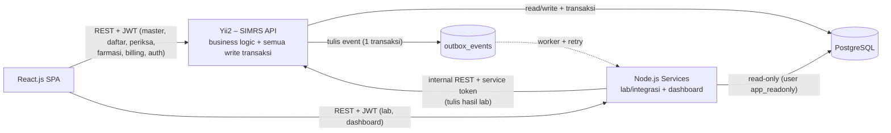
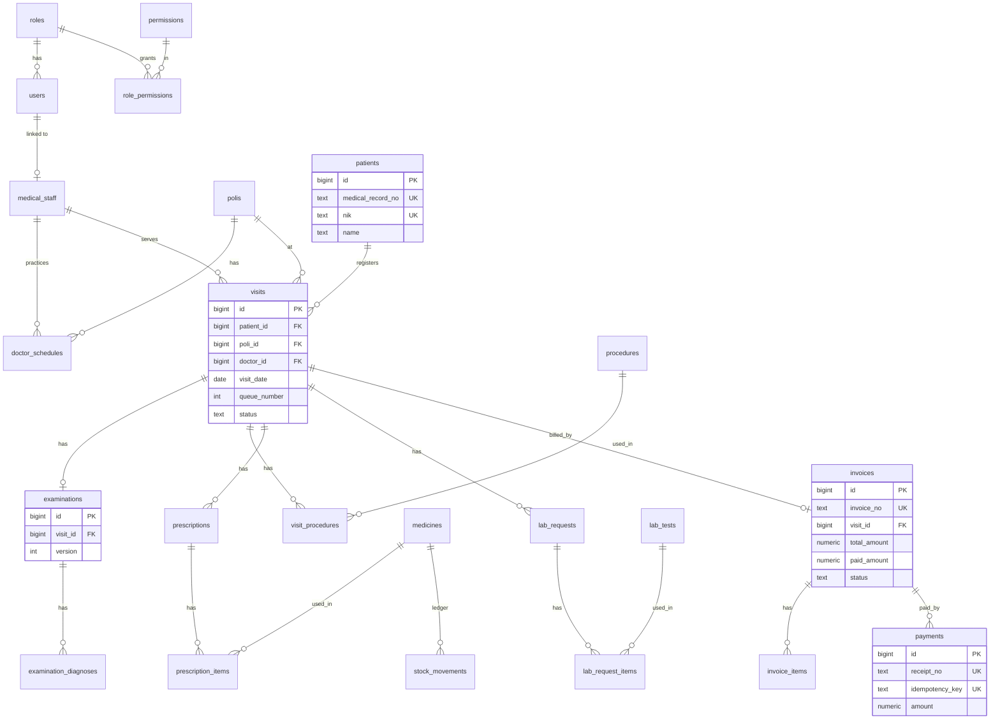

# SIMRS Rawat Jalan – Dokumen Arsitektur (Fase 1)

Stack: React.js · Yii2 · Node.js · PostgreSQL · Postman · Git

## 1. Diagram Arsitektur



## 2. Pembagian Tanggung Jawab Yii vs Node.js

Prinsip: **satu pintu tulis**. Semua perubahan data bisnis lewat Yii, jadi aturan bisnis tidak diduplikasi di Node.

| Area | Yii2 | Node.js |
|---|---|---|
| Auth | Login, terbitkan JWT, kelola user/role | Verifikasi JWT (secret sama), cek permission dari claim |
| Master data, pasien | CRUD + validasi + anti duplikasi | – |
| Pendaftaran & antrean | Generate nomor antrean, status antrean | – |
| Pemeriksaan, diagnosis, tindakan | Seluruh logika + versioning | – |
| Farmasi & stok | Validasi stok, dispense atomik | – |
| Billing & pembayaran | Hitung tagihan, idempotency, status bayar | – |
| Lab | Buat permintaan, simpan hasil (endpoint internal) | REST API daftar permintaan, terima input hasil lalu teruskan ke Yii, terima event integrasi |
| Dashboard | – | Agregasi read-only (query ke view/tabel) |
| Outbox | Tulis event + worker pengirim | Consumer idempoten |

Aturan agar tidak terjadi inkonsistensi data:
1. Node **tidak pernah INSERT/UPDATE** tabel bisnis. DB user Node hanya `SELECT`.
2. Hasil lab yang masuk lewat Node tetap ditulis oleh Yii (`PUT /internal/lab-items/{id}/result`), jadi validasi, audit, dan billing tetap satu jalur.
3. Angka keuangan dihitung hanya di Yii/DB. Node cuma menjumlahkan data yang sudah final.

## 3. Alur Komunikasi

1. **Login:** React → `POST /api/auth/login` (Yii) → JWT (HS256, 1 jam) berisi `sub, username, role, perms[]`.
2. **Operasional:** React → Yii (`Authorization: Bearer <jwt>`) → PostgreSQL.
3. **Permintaan lab:** Dokter buat permintaan di Yii → Yii menulis `lab_requests` + `outbox_events (lab.requested)` dalam satu transaksi → worker mengirim ke Node `POST /api/v1/integration/events`.
4. **Hasil lab:** Petugas lab di React → Node `POST /api/v1/lab/items/{id}/result` → Node validasi request → Node memanggil Yii internal endpoint → Yii simpan + audit + sinkron tagihan.
5. **Dashboard:** React → Node `GET /api/v1/dashboard/*` → Node query read-only ke PostgreSQL.

## 4. Auth & RBAC

Payload JWT:

```json
{ "sub": 12, "username": "kasir01", "role": "cashier",
  "perms": ["billing.view","billing.manage","payment.create","report.view"],
  "iat": 1760000000, "exp": 1760003600 }
```

Matriks hak akses (✓ = boleh):

| Permission | Admin | Pendaftaran | Dokter | Farmasi | Lab | Kasir |
|---|:-:|:-:|:-:|:-:|:-:|:-:|
| user.manage | ✓ | | | | | |
| master.view | ✓ | ✓ | ✓ | ✓ | ✓ | ✓ |
| master.manage | ✓ | | | | | |
| patient.manage | ✓ | ✓ | | | | |
| medicine.manage | ✓ | | | ✓ | | |
| registration.manage | ✓ | ✓ | | | | |
| queue.view | ✓ | ✓ | ✓ | | | |
| exam.view | ✓ | | ✓ | | | |
| exam.manage | ✓ | | ✓ | | | |
| procedure.manage | ✓ | | ✓ | | | |
| prescription.view | ✓ | | ✓ | ✓ | | |
| prescription.manage | ✓ | | ✓ | | | |
| pharmacy.process | ✓ | | | ✓ | | |
| lab.request | ✓ | | ✓ | | | |
| lab.view | ✓ | | ✓ | | ✓ | |
| lab.result | ✓ | | | | ✓ | |
| billing.view | ✓ | | ✓ | | | ✓ |
| billing.manage | ✓ | | | | | ✓ |
| payment.create | ✓ | | | | | ✓ |
| report.view | ✓ | | | | | ✓ |

Matriks ini identik dengan seed di `database/001_schema.sql`. Di Yii dipasang lewat `AccessControl` filter berbasis permission code; di Node lewat middleware `requirePermission('lab.result')`.

## 5. ERD



Tabel pendukung yang berdiri sendiri: `queue_counters` (counter antrean per dokter/hari), `audit_logs` (jejak perubahan), `outbox_events` (antrean event integrasi).

## 6. Pemetaan Skenario D → Mekanisme

| # | Skenario | Mekanisme | Bukti |
|---|---|---|---|
| 1 | Duplikasi pendaftaran | `queue_counters` naik atomik via `INSERT … ON CONFLICT DO UPDATE … RETURNING` (baris counter terkunci sampai commit, cek kuota ikut aman); unique `(doctor_id, visit_date, queue_number)`; unique parsial `(patient_id, poli_id, visit_date)` untuk kunjungan aktif | `RegistrationService`; tes `ConcurrencyTest` (10 request paralel pasien sama → 1 berhasil; 12 pasien paralel → antrean unik tanpa celah); `002_constraint_tests.sql` |
| 2 | Konkurensi stok | `UPDATE medicines SET stock = stock + :delta WHERE id = :id AND stock + :delta >= 0 RETURNING stock` (0 baris → 409), urutan kunci per `medicine_id` (cegah deadlock), `CHECK (stock >= 0)`, unique dispense per item, resep dikunci `FOR UPDATE` | `StockService`, `PrescriptionService`; tes paralel: 2 resep berebut stok terakhir → 1 berhasil, stok 1 (tidak minus) |
| 3 | Pembayaran ganda | Header `Idempotency-Key` wajib; kunci sudah ada → pembayaran lama dikembalikan (200, `replayed`); request kembar bersamaan → unique violation ditangkap lalu dijawab dengan pembayaran pemenang; kunci sama nominal beda → 422. Trigger mengunci invoice & menolak bayar melebihi sisa | `PaymentService`; tes: 6 retry paralel → 1 baris; 2 kasir melunasi bersamaan → tidak melebihi total |
| 4 | Ubah data setelah billing | Pemeriksaan final tetap bisa dikoreksi **dengan alasan wajib**; diagnosis/tindakan tidak dihapus: `voided_at` + alasan + baris baru; `audit_logs` (old/new/user/alasan) lewat trigger; item invoice di-void, total dihitung ulang trigger, `revision` naik; kelebihan bayar → **refund** tercatat (`payments.kind = refund`, maks. sebesar kelebihan) | `ExaminationService`, `BillingService`; `ChangeAfterBillingTest`; riwayat di `GET /api/visits/{id}/examination/history` |
| 5 | Gangguan integrasi | Yii → Node: transactional outbox + worker `php yii outbox/run` (backoff 5s, 10s, 20s… maks 1 jam, `failed` setelah 8x untuk ditinjau); Node → Yii: retry dengan `Idempotency-Key` yang sama, endpoint internal idempoten (`idempotency_keys`); Node mati / Yii mati tidak menghilangkan data | `OutboxService`, `IdempotencyService`; `IntegrationTest` (Node mati → event tetap `pending` & dijadwalkan ulang); tes Node (Yii mati → 503, retry kunci sama) |
| 6 | Performa | Index per pola query (`visits(poli_id, visit_date)`, partial index `voided_at IS NULL`, trigram cari nama), paginasi di semua list, eager loading relasi (`with()`), agregasi dashboard di SQL, `statement_timeout` di Node, schema cache Yii di produksi, user read-only untuk Node | Bagian 10 `001_schema.sql`, `services-node/src/routes/dashboard.js` |

Kelebihan bayar setelah koreksi (mis. tindakan dibatalkan setelah lunas) ditampilkan sebagai `overpaid_amount` di invoice dan diselesaikan dengan refund (`POST /api/invoices/{id}/refunds`) yang tercatat di riwayat pembayaran dan bukti refund. Dashboard menghitung pendapatan bersih (pembayaran − refund).

## 7. Keputusan Teknis

| Keputusan | Alasan |
|---|---|
| Yii2 | Migration, RBAC filter, dan REST bawaan lebih matang dibanding Yii1 |
| Soft delete untuk master, void untuk transaksi | Riwayat medis & keuangan tidak boleh hilang |
| Snapshot harga di tabel transaksi | Perubahan tarif tidak mengubah tagihan lama |
| Constraint di database, bukan hanya di aplikasi | Aman terhadap race condition antar request |
| `text + CHECK` bukan enum PostgreSQL | Lebih mudah diubah lewat migration |
| JWT HS256 dengan secret bersama | Sederhana untuk skala test; bisa diganti RS256 di produksi |
| Konteks audit via `SET LOCAL app.user_id` | Trigger tahu siapa pelaku tanpa mengubah tiap query |

## 8. Struktur Repository

```
simrs/
├── database/        001_schema.sql, 002_constraint_tests.sql
├── docs/            01_arsitektur.md, (api, ERD png, dst.)
├── backend-yii/     Yii2: business logic & semua write (lihat backend-yii/README.md)
├── services-node/   Node.js: API lab/integrasi + dashboard read-only
├── frontend/        React.js: aplikasi petugas (lihat frontend/README.md)
└── postman/         collection (Fase 4)
```

## 9. Cara Pasang Database

```bash
createdb simrs
psql -d simrs -v ON_ERROR_STOP=1 -f database/001_schema.sql
psql -d simrs -f database/002_constraint_tests.sql   # opsional, rollback otomatis
```

Opsional, user read-only untuk Node:

```sql
CREATE ROLE app_readonly LOGIN PASSWORD 'ganti-ini';
GRANT CONNECT ON DATABASE simrs TO app_readonly;
GRANT USAGE ON SCHEMA public TO app_readonly;
GRANT SELECT ON ALL TABLES IN SCHEMA public TO app_readonly;
```

## 10. Status

| Bagian | Status |
|---|---|
| Database + ERD + constraint skenario D | selesai |
| Backend Yii2 (auth, RBAC, master data, alur pendaftaran → pembayaran, cetak invoice/struk) | selesai, 43 tes lolos, PHPStan level 5 bersih |
| services-node (lab, dashboard, integrasi, CORS) | selesai, 19 tes lolos |
| Frontend React (semua role, dashboard, master data) | selesai, uji end-to-end browser lolos, 18 screenshot di `docs/screenshots/` |
| Postman collection | berikutnya |
