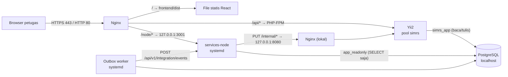

# Panduan Deploy ke Server

Penulis: Mochamad Mutaqin Kurniawan

`start-dev.bat` hanya untuk development di Windows. Di server, aplikasi dijalankan oleh Nginx, PHP-FPM, dan systemd, dan satu skrip (`deploy/setup-server.sh`) memasang semuanya di Ubuntu 24.04 dalam sekali jalan.

## Bedanya dengan di laptop

| Bagian | Di laptop (`start-dev.bat`) | Di server |
|---|---|---|
| Frontend React | `npm run dev` (Vite) | `npm run build`, folder `frontend/dist` dilayani Nginx sebagai file statis |
| Backend Yii2 | `php yii serve` (server bawaan PHP, 1 proses) | Nginx + PHP-FPM, pool khusus `simrs` |
| services-node | jendela CMD | service systemd `simrs-node`, hanya mendengar di `127.0.0.1:3001` |
| Outbox worker | jendela CMD | service systemd `simrs-outbox` |
| Proxy `/api` dan `/node` | proxy Vite | Nginx |
| PostgreSQL | user `postgres` | user aplikasi `simrs_app` (pemilik database) + `app_readonly` untuk Node |
| Secret & password | nilai contoh di `.env.example` | dibuat acak oleh skrip, `.env` hanya bisa dibaca user `simrs` |

Frontend memanggil path relatif (`/api/...`, `/node/...`), jadi kode tidak perlu diubah untuk produksi.

## Susunan di server



Yang terbuka ke internet hanya port 80/443. Node, Yii-internal (8080), dan PostgreSQL hanya bisa diakses dari dalam server, dan path `/internal/` diblokir di Nginx publik.

## Kebutuhan

- VPS **Ubuntu 24.04** (PHP 8.3 bawaan; Ubuntu 22.04 masih PHP 8.1, tidak cukup), minimal 2 GB RAM dan 20 GB disk.
- Akses SSH dengan `sudo`.
- Domain yang sudah diarahkan ke IP server bila ingin HTTPS. Tanpa domain, bisa memakai IP (HTTP saja).

## Instalasi otomatis (disarankan)

```bash
sudo apt-get update && sudo apt-get install -y git
sudo git clone https://github.com/mochmutaqin/simrs-rawat-jalan.git /var/www/simrs
cd /var/www/simrs

# dengan domain + HTTPS + data demo
sudo bash deploy/setup-server.sh simrs.contoh.com --demo --email admin@contoh.com

# atau hanya dengan IP, tanpa HTTPS, tanpa data demo
sudo bash deploy/setup-server.sh 203.0.113.10
```

| Opsi | Arti |
|---|---|
| `<domain-atau-ip>` | wajib; dipakai untuk `server_name` Nginx dan `CORS_ORIGINS` |
| `--demo` | isi data demo (8 akun per role, password `password123`, poli, dokter, jadwal, obat, pasien). Tanpa opsi ini hanya dibuat akun `admin` dengan password acak yang ditampilkan di akhir |
| `--email ALAMAT` | pasang sertifikat Let's Encrypt (HTTPS) dan redirect HTTP ke HTTPS; sertifikat diperpanjang otomatis oleh certbot |

Yang dikerjakan skrip:

1. Memasang Nginx, PostgreSQL, PHP-FPM + ekstensi (`pgsql`, `mbstring`, `intl`, `xml`, `curl`, `zip`), Composer, dan Node.js 22.
2. Mengatur zona waktu `Asia/Jakarta` dan membuat user sistem `simrs` sebagai pemilik aplikasi.
3. Membuat user database `simrs_app` dan database `simrs`, lalu menulis `backend-yii/.env` dan `services-node/.env` dengan secret acak (JWT, token antar-service, password database).
4. `composer install --no-dev`, `php yii migrate`, membersihkan schema cache, lalu membuat `app_readonly` dengan hak `SELECT` (termasuk untuk tabel dari migrasi berikutnya).
5. Membuat akun admin atau data demo.
6. `npm ci --omit=dev` untuk services-node.
7. `npm ci && npm run build` untuk frontend.
8. Memasang pool PHP-FPM, situs Nginx, service systemd `simrs-node` dan `simrs-outbox`, serta cron backup harian.
9. Memasang HTTPS (bila `--email`) dan mengecek keempat jalur: Yii, Node, frontend, `/node/health`.

Skrip aman dijalankan ulang: secret yang sudah ada di `.env` dipakai lagi dan data tidak dihapus. Jalankan ulang bila file di `deploy/` berubah.

## Isi folder `deploy/`

| File | Dipasang ke | Isi |
|---|---|---|
| `setup-server.sh` | dijalankan sekali | instalasi lengkap (lihat di atas) |
| `update.sh` | dijalankan tiap update | `git pull`, composer, migrasi + flush schema cache, `npm ci`, build frontend, restart service, cek kesehatan |
| `backup-db.sh` | cron `/etc/cron.d/simrs-backup` jam 01.30 | `pg_dump` format custom ke `/var/backups/simrs`, disimpan 14 hari |
| `nginx/simrs.conf` | `/etc/nginx/sites-available/simrs` | frontend, `/api` ke PHP-FPM, `/node` ke Node, blokir `/internal` publik, server lokal `127.0.0.1:8080`, cache aset, header keamanan |
| `php-fpm/simrs.conf` | `/etc/php/8.3/fpm/pool.d/simrs.conf` | pool PHP-FPM yang berjalan sebagai user `simrs` |
| `systemd/simrs-node.service` | `/etc/systemd/system/` | services-node, membaca `services-node/.env`, restart otomatis |
| `systemd/simrs-outbox.service` | `/etc/systemd/system/` | `php yii outbox/run`, restart otomatis |

## Isi `.env` produksi

Dibuat otomatis oleh skrip. Pasangan yang **harus sama**:

| backend-yii/.env | services-node/.env | Fungsi |
|---|---|---|
| `JWT_SECRET` | `JWT_SECRET` | Node memverifikasi token yang diterbitkan Yii |
| `INTERNAL_SERVICE_TOKEN` | `YII_SERVICE_TOKEN` | Node memanggil `/internal/*` di Yii (hasil lab) |
| `NODE_SERVICE_TOKEN` | `SERVICE_TOKEN` | outbox worker mengirim event ke Node |

Nilai khusus produksi lainnya: `YII_DEBUG=false`, `YII_ENV=prod` (error tanpa detail teknis, schema cache aktif), `HOST=127.0.0.1` di Node, `YII_BASE_URL=http://127.0.0.1:8080`, `NODE_BASE_URL=http://127.0.0.1:3001`, `CORS_ORIGINS` berisi domain.

## Perintah sehari-hari

```bash
# status & log
systemctl status simrs-node simrs-outbox nginx php8.3-fpm
journalctl -u simrs-node -f
journalctl -u simrs-outbox -f
tail -f /var/log/nginx/error.log /var/www/simrs/backend-yii/runtime/logs/app.log

# update setelah ada commit baru di GitHub
sudo bash /var/www/simrs/deploy/update.sh

# antrean event outbox, kirim ulang event yang gagal permanen
cd /var/www/simrs/backend-yii
sudo -u simrs php yii outbox/status
sudo -u simrs php yii outbox/retry-failed

# backup manual & pemulihan
sudo bash /var/www/simrs/deploy/backup-db.sh
sudo -u postgres pg_restore --clean --if-exists -d simrs /var/backups/simrs/<file>.dump
```

## Keamanan

- [x] Hanya port 80/443 yang menghadap internet; Node, Yii-internal, dan PostgreSQL di `127.0.0.1`.
- [x] `/internal/*` diblokir di Nginx publik; dari dalam server tetap butuh `X-Service-Token`.
- [x] Secret acak per server, `.env` mode `600` milik user `simrs`.
- [x] Node memakai user database read-only; Yii memakai user pemilik database, bukan superuser `postgres`.
- [x] `YII_DEBUG=false`: pesan error ke klien tanpa stack trace.
- [x] HTTPS via Let's Encrypt (`--email`).
- [ ] Ganti password akun demo, atau install tanpa `--demo`.
- [ ] Firewall (opsional): `sudo ufw allow OpenSSH && sudo ufw allow 'Nginx Full' && sudo ufw enable`. Pastikan port SSH yang dipakai sudah diizinkan sebelum `enable`.

## Masalah umum

| Gejala | Penyebab & solusi |
|---|---|
| `502 Bad Gateway` di `/node/...` | `simrs-node` mati: `journalctl -u simrs-node -n 50` |
| `502` di `/api/...` | PHP-FPM mati: `systemctl status php8.3-fpm`, cek socket `/run/php/simrs.sock` |
| Dashboard/laporan `401` padahal sudah login | `JWT_SECRET` beda antara Yii dan Node |
| Input hasil lab gagal (`503`) | `YII_SERVICE_TOKEN` ≠ `INTERNAL_SERVICE_TOKEN`, atau server Nginx `127.0.0.1:8080` tidak aktif |
| Event outbox menumpuk `pending` | Node mati atau `SERVICE_TOKEN` ≠ `NODE_SERVICE_TOKEN`; setelah diperbaiki, worker mengirim ulang otomatis |
| Error 500 setelah mengubah tabel manual | schema cache basi: `sudo -u simrs php yii cache/flush-schema db --interactive=0` |
| Nginx gagal start: `[::]:80 Address family not supported` | server tanpa IPv6; baris `listen [::]:80` di konfigurasi sengaja dikomentari, jangan diaktifkan |

## Sudah diuji

Konfigurasi ini diuji di Ubuntu 24.04 (Nginx 1.24, PHP 8.3-FPM, PostgreSQL 16, Node 22) dengan susunan folder dan user yang sama:

- alur end-to-end lengkap (semua role, cetak, laporan, unduh CSV, tampilan HP) berjalan lewat Nginx, bukan Vite, tanpa error console atau HTTP 5xx;
- Node hanya mendengar di `127.0.0.1:3001`, `/internal/*` dari publik dibalas 404, `/.env` ditolak;
- migrasi berjalan sebagai `simrs_app` (bukan superuser), `app_readonly` bisa membaca tetapi ditolak saat menulis, dan tabel baru otomatis ikut terbaca;
- outbox worker mengirim event ke Node; backup bisa dibaca kembali dengan `pg_restore`.

Lingkungan uji tidak memakai systemd, jadi service dijalankan dengan perintah, user, dan file `.env` yang sama dengan isi unit systemd. Pengujian ini juga menemukan dan memperbaiki dua hal yang hanya muncul di produksi: schema cache yang basi setelah migrasi pertama (login gagal 500) dan Nginx yang gagal start di server tanpa IPv6.
